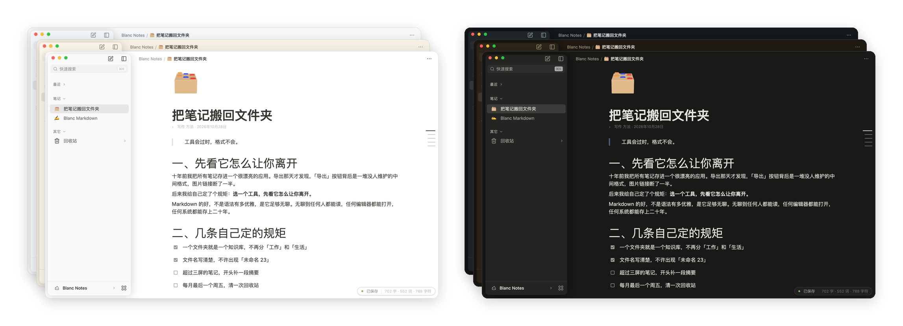
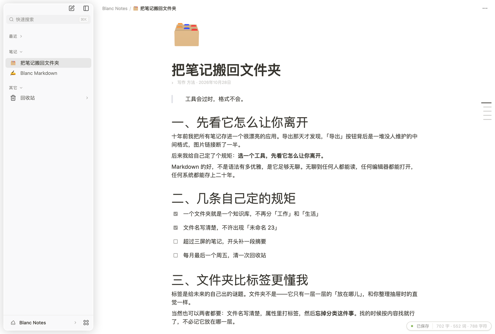

<div align="center">
  
  <h3>Blanc</h3>
  <p>A local-first Markdown notebook. One note, one window — every note is just a .md file on your disk.</p>
  <p>
    <a href="https://github.com/Jfreey/Blanc/releases/latest"><b>Download for macOS · 5 MB</b></a><br>
    <sub>Apple Silicon · macOS 11+ · requires Node.js 18+ on your system</sub>
  </p>
  <sub><a href="README.zh-CN.md">简体中文</a> · <b>English</b></sub>
</div>

---

## In one sentence

Blanc has Notion's face and a folder's bones.

No account, no database, no "syncing" spinner. Every note you write lives on your own disk as a `.md` file that any editor can open. Delete the app and the notes are still there; move to another machine and you just copy the folder.



Three color schemes × light and dark = six looks.

## What you notice right away

- **Icons are yours.** Files, folders, libraries, document titles — change any of them.
- **Drag and drop that actually drags.** Drag files in the sidebar, drag blocks in the body. Drop targets light up, and things land where you let go.
- **One note, one window.** Not in-app tabs — real macOS windows. Tile them, spread them across displays, reach them with `Cmd+Tab`.
- **Dark mode is genuinely tuned.** Each of the three schemes has its own light and dark values, with selections, borders, and shadows chosen separately.
- **5 MB to download, 13 MB installed.** No bundled Chromium; the UI runs on the system WebView, and the backend is a zero-dependency Node file server.



## What it does

### Icons, whenever you want one

Every item can have its own face. Icons come from three places:

- **Curated built-ins** — 17 categories (files, notes, editing, status, places, time, brands…)
- **All 1,877 Lucide icons** — searchable in English or Chinese, with tags like "diary" and "travel" already mapped
- **Any emoji** — paste one into the filter box and it works; no need to stay inside the built-in set

Afterwards you can pick a color — red, orange, yellow, green, blue, purple, gray — or leave it to follow the theme. Breadcrumbs only show the little icon once you've actually changed it; untouched items stay clean.

The whole icon library is lazy-loaded: unless you open the picker, those four thousand rows are never downloaded.

### Drag and drop, done properly

**In the sidebar:**

- Drop into another folder and the file really moves (across volumes, into nested folders — the server blocks nonsense like moving a folder into itself)
- Drop elsewhere at the same level to reorder; the order is written to the library's `.order` table, so it's still your arrangement next time
- Drag a folder to the edge and it expands on its own — no need to open it first

**In the body:**

- Drag the block handle to move a single block
- Select several blocks and drag — the group moves together, never split apart
- List items reorder within a list, dragged out they flatten into paragraphs, dragged in they become list items
- A translucent ghost follows the pointer; valid drop targets light up, and invalid ones tell you so

Four sort orders: manual, by name, by created, by modified. Manual has one nice touch — newly added files land **after** what you've arranged, never shoving aside a spot you placed.

### One note, one window

No in-app tabs. Double-click a `.md` in Finder and it opens in a new window; the same file never opens twice — if it's already open, it comes to the front.

Each window is another webview in the same process, so there's only one backend: no port negotiation, no second Node process. Set Blanc as the default app for `.md` and you land straight in the editor.

**Files outside a library open too.** Drag any `.md` from your desktop in and it gets its own window. The path bar shows "External file / Users / … / that-note", folding the middle into an ellipsis when it gets long — the ends are always visible.

### Where you write

- Notion-style block editing: headings, lists, quotes, code blocks, tables, to-dos
- **frontmatter properties**, edited visually: tags, dates, and custom fields; add them, rename them, change type (text / number / date / multi-select), and show them always, collapsed, or hidden
- **Text and background colors**, saved as inline `<span>` so they survive in other editors
- **Find and replace** in the page: `⌘F` to find, `⌘R` to replace
- **Three-stage `⌘A`**: select the text in a block, press again to select the whole block (frame included), a third time to select everything. `⌫` on a block selection removes the block without leaving blank lines. `Alt`-click adds another block to the selection
- **Lock** the current note read-only, so you can't break it while reading a long one
- **Full-width mode**: the body spans the whole editor
- **Body text 15–18 px, four paragraph spacing levels** — applied instantly, no restart

In the small capsule at the bottom right, word count, character count, and characters can be combined however you like, or turned off entirely. Next to it, "Saved / Saving…" is always there. Autosave debounces at 0.8 s; `⌘S` writes immediately without waiting.

### Reading long notes

A thin rail runs down the right edge. Each tick is a heading, shorter ticks mean deeper levels, and clicking one scrolls there smoothly.

- Hover the rail to expand the full outline
- Or keep just the rail — the ticks are clickable directly
- **Mini mode**: a shorter index; hover to see a snippet of that section, handy when you're trying to remember what a note was about

### Keeping things tidy

- Multiple libraries, switchable at any time, each with its own icon
- `⌘K` quick search across files and folders, all libraries
- Deleting goes to a **trash** first: preview in place, restore, clear one item, or empty the lot
- Rename, create folders, drag to move — all done in the sidebar

### Appearance

Three schemes (Paper, Sand, Slate) × light/dark × follow system. These are **two dimensions**: "Sand + follow system" is Sand's dark variant, not the default scheme's dark variant.

The window background is painted before the window is created — switch to dark, open a new window, and there's no white flash.

## How light it is

| | |
|---|---|
| Download | **5 MB** (compressed), **13 MB** installed |
| First paint | 356 KB JS (gzip **109 KB**) + 72 KB CSS (gzip 14 KB), ~**30 ms** locally |
| Editor | 1.3 MB (gzip 395 KB), **loaded when you open the first note**, ~0.5 s locally |
| Backend | one Node process, ~**60 MB** resident |
| Multiple windows | one per note; opening a sixth adds no process |

**No Chromium inside.** The UI runs on the system WebView, so a 13 MB `.app` contains a Rust shell, a Node executable, and the frontend files you see in this repo.

Fast to load: the first screen needs only 356 KB of JS.

**The backend is the Node standard library** — no framework, no database, no second runtime. File tree, icons, and trash indices are all read and written in that one process, entirely within 60 MB.

## Architecture

```
Tauri shell (Rust)
  single-instance · window registry · external file I/O · backend supervisor
   └── Webview window × N (one React root each, independent)
        └── HTTP 127.0.0.1:8787
             └── server.mjs (Node stdlib, zero dependencies)
                  └── your .md files
```

| | |
|---|---|
| Editor | [Milkdown](https://milkdown.dev) + Crepe (ProseMirror) |
| Framework | React 19 · Vite 8 |
| Desktop shell | Tauri 2 (macOS / WKWebView) |
| Backend | Node standard library, no framework, no database |
| Styling | hand-written CSS + CSS variable themes |
| Icons | all of Lucide (ISC), inlined and loaded on demand |

Reading and writing absolute paths outside a library goes through Tauri Rust commands that only this app's own windows can call.

## Running it

```bash
npm install
npm run tauri:build
```

The bundle lands at `desktop/src-tauri/target/release/bundle/macos/Blanc.app`.

On first launch it asks whether to create a library: put `Blanc Notes` in your home folder, use `~/.blanc`, or pick an existing folder. **Close the window without choosing and not a byte is written** — it asks again next time. Config lives in `~/.blanc/config.json`; delete it to run onboarding again.

Everyday development:

```bash
npm run tauri:dev    # Tauri with hot reload
npm run dev:all      # browser only: backend on 8787 + frontend on 5173
npm run check        # four static checks + build
```

Browser automation goes through `scripts/cdp.mjs` (Edge + CDP, no third-party dependencies):

```bash
node scripts/cdp.mjs open "http://localhost:5173"
node scripts/cdp.mjs eval "<js expression>"
```

> If you reinstall locally a lot and would rather not re-approve "access your Documents folder" each time, run `./scripts/make-signing-cert.sh` once — it creates and trusts a local self-signed certificate. Builds then sign with it automatically, and macOS treats them as the same app.

## Layout

```
src/                frontend
  App.jsx           shell, sidebar, settings, drag and drop
  EditorPane.jsx    Milkdown instance, property header, block drag, find/replace
  OutlineRail.jsx   right-edge index (rail / outline / mini)
  colorMarks.jsx    text and background colors
  lucideAll.js      full Lucide set (lazy)
server.mjs          file server (~850 lines, zero dependencies)
desktop/src-tauri/  Rust shell
scripts/            static checks + CDP automation
```

## Not done yet

An honest list, roughly in the order I'd like to tackle it:

- [ ] Sync / multi-device (purely local today)
- [ ] Windows / Linux support (`icon.ico` is still a placeholder)
- [ ] Developer ID signing + notarization, so downloads open without a warning
- [ ] QuickLook preview extension (code is written, waiting on the signing flow)
- [ ] Import themes from a file
- [ ] `⌘,` to open settings
- [ ] Custom keybindings (today it's a read-only list of shortcuts that have been tried)
- [ ] Cover images and comment blocks

## License

**MIT** (see [`LICENSE`](LICENSE)). Dependencies are MIT / Apache-2.0 / ISC, all compatible.

The self-hosted **Inter** and **Rubik** fonts are under **SIL OFL-1.1** (see [`public/fonts/LICENSE.md`](public/fonts/LICENSE.md)) — OFL requires the license to ship with the fonts, which is satisfied here, and both are compatible with MIT.
