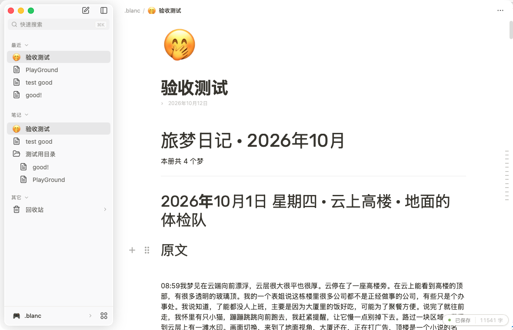

<div align="center">
  
  <h3>Blanc</h3>
  <p>本地优先的 Markdown 笔记。一篇一个窗口，笔记就是磁盘上的 .md 文件。</p>
</div>

---

## 一句话

Blanc 长着一张 Notion 的脸，骨子里是一个文件夹。

没有账号，没有数据库，没有「正在同步」。你写的每一篇都躺在自己的磁盘上，
是一个任何编辑器都能打开的 `.md`。应用没了，笔记还在；换台电脑，把文件夹拷走就行。

## 打开就能感觉到的几件事

- **图标是自由的。** 文件、文件夹、知识库、文档标题——想换成什么就换成什么。
- **拖拽是真能拖的。** 侧栏拖文件、正文拖块，落点会亮，松手就到位。
- **一篇一个窗口。** 不是应用内标签页，是 macOS 原生窗口，可以并排、可以跨屏、可以 Cmd+Tab。
- **暗色是真的调过的。** 三套配色各自有亮/暗两版，选区、描边、投影都单独取值。
- **安装包 12 MB。** 后端是一个零依赖的 Node 文件服务，不是一整套框架。



## 它都会些什么

### 图标，想加就加

每个条目都能有自己的脸。图标有三种来源：

- **内置精选**——17 个分类（文件、笔记、编辑、状态、地点、时间、品牌……）里挑；
- **Lucide 全量 1877 枚**——中英文关键词都能搜，标签里连「日记」「旅行」这种词都配好了；
- **任意 emoji**——筛选框里直接粘一个进来就能用，不受内置表限制。

选完还能再挑一层颜色：红橙黄绿蓝紫灰，不挑就跟着主题走。
面包屑里也只在你**真的换过图标**之后才显示那枚小图标，没换过的地方干干净净。

整个图标库是懒加载的：你不点开筛选框，那四千行数据根本不会被下载。

### 拖拽，是认真做的

**侧栏里：**

- 拖进别的文件夹 = 真的把文件搬过去（跨盘也好、嵌套也好，服务端会拦住「搬进自己里面」这种蠢事）；
- 拖到同一层的别的位置 = 重排，顺序写进库里那张 `.order` 表，下次打开还是你摆的样子；
- 文件夹拖到边缘会自己展开，不用先点开再拖。

**正文里：**

- 拖块把手，单块搬家；
- 框选好几个块再拖，整组一起走，不会被拆散；
- 列表项能在列表里换位置，拖出列表自动摊平成段落，拖进列表自动变成列表项；
- 拖动时有一个半透明幽灵跟着指针，哪儿能落哪儿亮，不能落的地方会明确告诉你不行。

排序给了四档：手动、按名称、按创建时间、按修改时间。手动档有个小体贴：
新加的文件排在已经排好的序列**后面**，不会一进门就把你摆好的位置顶开。

### 一篇一个窗口

不做应用内标签页。从 Finder 双击 `.md` 就开一个新窗口，同一个文件不会开第二遍——
已经开着就把它叫到前面来。

新窗口是同一个进程里的另一个 webview，所以后端只有一份，不需要端口协商，也不需要
第二个 Node 进程。可以把 Blanc 设成 `.md` 的默认编辑器，双击就进编辑状态。

**库外的文件也能开。** 桌面上随手一个 `.md`，拖进来就是一个独立窗口，路径条会显示
「外部文件 / Users / … / 那一篇」，中间太长就折叠成省略号，首尾永远看得见。

### 写东西的地方

- Notion 式块编辑，标题、列表、引用、代码块、表格、待办都齐；
- **frontmatter 属性头**：标签、日期、自定义属性都能可视化编辑，能加、能改名、能换类型
  （文本 / 数字 / 日期 / 多选），显隐还分三档——常显、折叠、彻底藏起来；
- **文字和背景着色**，颜色以行内 `<span>` 落盘，用别的编辑器打开也还在；
- **页内查找与替换**，`⌘F` 找、`⌘R` 替换；
- **`⌘A` 三段升级**：先选这一块的文字，再按升格成整块选中（有块框），第三次框住全文；
  块选中时按 `⌫` 连块一起删，不留一堆空行；`Alt` 点击可以加选一个块；
- **锁定**：把当前文档钉成只读，看长文的时候手滑也不会改坏；
- **全宽模式**：正文不限宽，铺满整个编辑区；
- **正文字号 15–18px、段落间距四档**，改完立刻生效，不用重启。

右下角那半颗胶囊里，字数、词数、字符数可以任意组合显示，也可以全关掉；
旁边那颗「已保存 / 保存中…」一直在。自动存盘 0.8 秒防抖，`⌘S` 立刻落盘不等它。

### 看长文的时候

右缘有一条细轨，每一条横线是一个标题，线越短层级越深，点一下平滑滚过去。

- 悬停导航条，展开完整大纲；
- 只留导航条也行，刻度线直接可点；
- **迷你模式**：换成更短的索引条，悬停出那一段的片段预览——想快速回忆「这篇写了啥」时很顺手。

### 收拾东西

- 多知识库，随时切换，每个库还能有自己的图标；
- `⌘K` 快速搜索，跨库找文件和目录；
- 删除先进**回收站**，可以站内预览、还原、单条清空，或者一次倒干净；
- 重命名、新建文件夹、拖拽移动，都在侧栏就地完成。

### 外观

三套配色（纸白 / 米色 / 冷灰）× 明暗两版 × 跟随系统。这是**两个维度**：
「米色 + 跟随系统」是米色的暗色版，不是默认色的暗色版。

窗口底色会在建窗之前就按你的主题铺好——切到暗色再开新窗口，不会有一帧白光闪你。

## 几个做起来比看起来麻烦的地方

**编辑器是懒加载的。** 主包一度是 1.99 MB（gzip 615 KB），因为 Milkdown + ProseMirror + KaTeX
全被静态拉进了首屏，而首屏一个都用不到。改成动态 import 之后：0.34 MB（gzip 108 KB），
CSS 从 151 KB 降到 68 KB。代价只是打开第一篇时等一下本地 chunk，用骨架屏兜住。

**字数统计单独住一个小模块。** 它原本在编辑器里，可一旦从外壳 `import` 它，
整个编辑器就被拽回关键路径，懒加载白做。

**拖拽的落点是自己算的。** HTML5 的 `dragover` 是节流的，松手那一刻的坐标可能和缓存的
对不上，所以 `drop` 里要用事件自己的坐标重算一遍。列表项还得单独找「最内层 listItem」——
把手挂在正文列左边外面，拿它的 x 去问 ProseMirror 是问不出位置的。

**写入用乐观锁。** 两个窗口打开同一篇时，后保存的一方会收到冲突提示，由人来决定留哪份。
不自动合并，因为「覆盖」和「丢弃」都是错的。

**索引写入串行排队。** `.order` / `.icons` / `.trash` 三份索引都是「读出来、改几个键、写回去」。
两个窗口同时拖动时，后写的一方会把先写的整份盖掉；更糟的是 `writeFile` 不是原子的，
交叠时可能留下半截 JSON。一条 Promise 链就够了，不需要任何依赖。

**四个静态检查。** 每个都对应一次真实的线上事故，不是摆设：

| 检查 | 拦什么 |
|---|---|
| `check-window-opts` | 主窗口与运行时窗口参数漂移（漏 `dragDropEnabled` 会让块拖动直接失效） |
| `check-undeclared-idents` | 引用了没声明的标识符（构建抓不到，运行时报错） |
| `check-tdz` | 暂时性死区白屏 |
| `check-scope` | 作用域越界 |

## 架构

```
Tauri 壳 (Rust)
  single-instance · 窗口登记表 · 库外文件读写 · 托管后端进程
   └── Webview 窗口 × N（每个窗口一份 React 根，互不相干）
        └── HTTP 127.0.0.1:8787
             └── server.mjs（Node 标准库，零依赖）
                  └── 你的 .md 文件
```

| | |
|---|---|
| 编辑器 | [Milkdown](https://milkdown.dev) + Crepe（ProseMirror） |
| 框架 | React 19 · Vite 8 |
| 桌面壳 | Tauri 2（macOS / WKWebView） |
| 后端 | Node 标准库，无框架、无数据库 |
| 样式 | 手写 CSS + CSS 变量主题 |
| 图标 | Lucide（ISC）全量内联，按需加载 |

一条有意的边界：**库外文件不走 HTTP。** 后端的路径拼接把一切锁在知识库根目录内；
读写库外的绝对路径走 Tauri 的 Rust 命令，只有本应用自己的窗口能调。

## 跑起来

```bash
npm install
npm run tauri:build
```

产物在 `desktop/src-tauri/target/release/bundle/macos/Blanc.app`。

首次启动会问你要不要建知识库：可以在用户目录下创建 `Blanc Notes`，也可以直接用
`~/.blanc`，或者挑一个现成的文件夹。**不选就关窗，磁盘上不会多出一个字节**，
下次启动接着问。配置存在 `~/.blanc/config.json`，删掉就重新走一遍引导。

日常开发：

```bash
npm run tauri:dev    # Tauri 热重载
npm run dev:all      # 纯浏览器：后端 8787 + 前端 5173
npm run check        # 四个静态检查 + 构建
```

浏览器自动化走 `scripts/cdp.mjs`（Edge + CDP，无第三方依赖）：

```bash
node scripts/cdp.mjs open "http://localhost:5173"
node scripts/cdp.mjs eval "<js 表达式>"
```

> 本机反复重装时，如果不想每次都重新允许「访问文档文件夹」，先跑一次
> `./scripts/make-signing-cert.sh`（生成一张本机自签名证书并信任）。
> 之后构建会自动用它签名，macOS 就会认为还是同一个应用。

## 目录

```
src/                前端
  App.jsx           壳、侧栏、设置面板、拖拽
  EditorPane.jsx    Milkdown 实例、属性头、块拖动、查找替换
  OutlineRail.jsx   右缘索引（导航条 / 大纲 / 迷你）
  colorMarks.jsx    文字与背景着色
  lucideAll.js      Lucide 全量图标（懒加载）
server.mjs          文件服务（850 行，零依赖）
desktop/src-tauri/  Rust 壳
scripts/            静态检查 + CDP 自动化
```

## 还没做的

一份诚实的清单，按「想做」的顺序：

- [ ] 同步 / 多端（目前是纯本地，好事也是坏事）
- [ ] Windows / Linux 适配（`icon.ico` 还是占位图）
- [ ] Developer ID 签名 + 公证，让别人下载就能直接打开
- [ ] QuickLook 预览扩展（代码已写好，等签名流程一起开）
- [ ] 从文件导入主题
- [ ] `⌘,` 打开设置
- [ ] 快捷键自定义绑定（现在是一份「按下去验过的」只读清单）
- [ ] 封面图与评论区块

## 许可

**MIT**（见 [`LICENSE`](LICENSE)）。依赖均为 MIT / Apache-2.0 / ISC，与之兼容。

自托管的 **Inter** 与 **Rubik** 字体遵循 **SIL OFL-1.1**
（见 [`public/fonts/LICENSE.md`](public/fonts/LICENSE.md)）——OFL 要求随字体附带许可，
这一条已满足，两者与 MIT 兼容。
